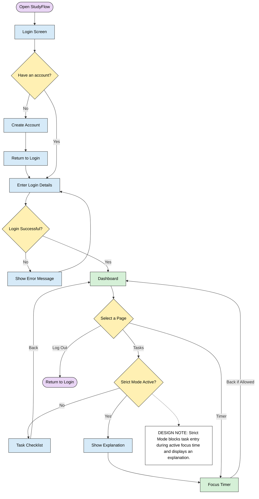

# StudyFlow – Sprint 2 Flowcharts and Logic Maps

Prepared by: Christina Ramazani  
Course: CSE 350 – Introduction to Software Engineering

## 1. Application View-Switching Flowchart

This flowchart shows how users move between the main pages of StudyFlow and how the application handles login errors and Strict Mode restrictions.

### Design Notes

- Successful authentication directs the user to the dashboard.
- Invalid login information displays an error and allows another attempt.
- Users can navigate between the task checklist and focus timer.
- Strict Mode prevents task entry during an active focus session and displays an explanation.
- Logging out returns the user to the login screen.
